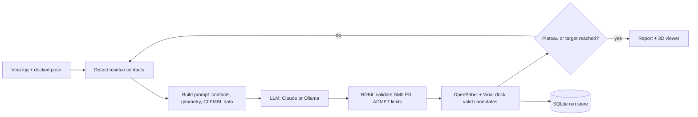

# AI-Guided Docking Pipeline

A generalised, AI-guided structure-based drug design pipeline. Works with any protein
target, any PDB structure, and any binding site (initially built for but not limited to MRP1). 
Parses AutoDock Vina logs, retrieves live ChEMBL reference data, auto-detects residue contacts,
builds a target-specific system prompt, calls Claude (or a local Ollama model) for scaffold
modification suggestions, validates returned SMILES with RDKit, and can auto-dock
candidates across multiple autonomous optimisation cycles providing a binding affinity output 
(kcal/mol).


Two entry points:
- `docking_pipeline.py`: command-line pipeline
- `docking_app_v2.py`: Streamlit web interface (autonomous iterative loop, in-browser
  3D pose viewer via 3Dmol.js, plateau-detection auto-stop)

<!-- TODO: add a screenshot of the app here (docs/screenshot.png) -->

## Quick start

### With Docker

```bash
docker build -t docking-app .
export ANTHROPIC_API_KEY="your-key-here"       # never commit this
docker run -p 8501:8501 -e ANTHROPIC_API_KEY -v "$(pwd)/data:/app/data" docking-app
# open http://localhost:8501
```

The image includes AutoDock Vina and OpenBabel. `./data` keeps your run history and saved poses.

### Without Docker

```bash
pip install -r requirements.txt
```

Install [AutoDock Vina](http://vina.scripps.edu/) and [OpenBabel](https://openbabel.org/)
locally (on Ubuntu: `sudo apt install openbabel autodock-vina`), and have a receptor PDBQT file
for your target.

```bash
export ANTHROPIC_API_KEY="your-key-here"       # required, never commit this
export VINA_PATH="/path/to/vina"               # optional override
export OBABEL_PATH="/path/to/obabel"           # optional override
streamlit run docking_app_v2.py
```

Upload a receptor PDBQT, enter target and grid details (pre-filled with MRP1/5UJA defaults),
optionally upload a Vina log and docked ligand PDBQT, and run one or more autonomous
optimisation cycles interactively, with 3D pose visualisation and per-cycle downloads.
Requires `docking_pipeline.py` in the same folder.

## Public deployment

The app needs two command-line binaries (`vina`, `obabel`), so it cannot be hosted
anywhere that only serves static files. It is deployed on **Streamlit Community Cloud**,
which installs Debian packages from `packages.txt` alongside the pip packages in
`requirements.txt`.

`packages.txt` must contain bare package names and nothing else. Community Cloud
passes the file's words straight to `apt-get install`, and it does not strip
comments: a `#` line mentioning a flag like `--ligand` makes apt fail with
`Command line option --ligand is not understood`, and the whole install aborts.

1. Push this repository to GitHub (public, or private with Community Cloud granted access).
2. At [share.streamlit.io](https://share.streamlit.io), deploy `docking_app_v2.py` from
   this repository.
3. Under **Advanced settings → Secrets**, add the API key in TOML form:

   ```toml
   ANTHROPIC_API_KEY = "sk-ant-..."
   ```

   Root-level secrets are also exported as environment variables, which is how the
   Anthropic SDK picks the key up — no code change needed.

What to expect from the free tier:

- **2 CPU cores, ~2.7 GB RAM.** Vina is CPU-bound, so a full ten-cycle run takes a
  while and two simultaneous users make each other slower.
- **The disk is not persistent.** `data/runs.db` and saved poses are lost on every
  redeploy or wake-from-sleep, so download each cycle's results if you want to keep them.
- **The app sleeps after 12 hours without traffic** and wakes on the next visit.
- **Vina 1.2.7 and Open Babel 3.1.1**, from Debian 13 "trixie" — the same Vina
  version used in development, so scores are directly comparable. (The Streamlit
  docs still say Debian 11; the build log says otherwise. Trust the log.) Every
  run records the version it used via `src/provenance`.
- **Visitors spend the API key's credits.** Set a spend limit on a dedicated key.

`Dockerfile` is still the way to self-host or run it locally with a persistent volume,
and is what you would use on a paid host; Hugging Face Spaces now requires a paid plan
to create a Docker Space.

## Command-line usage

```bash
python docking_pipeline.py \
    --log compound_vina.log \
    --smiles "CCO..." \
    --receptor path/to/receptor.pdbqt \
    --center_x 45.0 --center_y 32.0 --center_z 18.0 \
    --size_x 25.0 --size_y 25.0 --size_z 25.0 \
    --target "EGFR kinase" \
    --pdb_id 1IEP \
    --cavity "ATP binding pocket, hinge region" \
    --key_residues "Thr790,Met793,Lys745,Glu762" \
    --chembl_id CHEMBL203 \
    --mode affinity \
    --chembl \
    --n 3 \
    --autodock \
    --yes
```

Example from the MRP1 project specifically:

```bash
python docking_pipeline.py \
    --log smiles4_log.txt --smiles "..." \
    --receptor 5UJA_receptor.pdbqt \
    --center_x 94.806 --center_y 59.056 --center_z 56.653 \
    --size_x 21.920 --size_y 21.297 --size_z 23.806 \
    --target "MRP1 (ABCC1)" --pdb_id 5UJA \
    --key_residues "Thr1241,Lys332,Gln450,Phe594,Met1092,Trp1245,Tyr1032" \
    --mode affinity --chembl --n 3 --autodock --yes
```

Output: `<name>_report.txt` with AI suggestions, RDKit validation, and docking results.

## How a cycle works



## Run history and reproducibility

Every web-app run is saved to `data/runs.db` (SQLite) with:

- the target, grid, Vina settings, LLM backend and model, and a SHA-256 of the receptor file,
- Python and package versions, the Vina version, and the git commit,
- start time, end time, and status (`completed`, `failed` or `cancelled`),
- one row per compound for every cycle: SMILES, Vina score (kcal/mol, more negative is better),
  and the saved pose in `data/poses/<run_id>/`.

```python
from provenance import RunStore
store = RunStore("data/runs.db")
run_id = store.list_runs()[0]["run_id"]
print(store.get_run(run_id)["params"])
print(store.best_results(run_id, n=5))
```

**What the "Fix random seed" option does:** it passes `--seed 42` to Vina, so Vina's search is
repeatable for a given prepared ligand file. The 3D structure of each ligand is generated from its
SMILES by OpenBabel, which is not seeded, so scores for the same SMILES can still differ slightly
between runs. See `NEXT_STEPS.md`.

## Tests

```bash
pip install -r requirements-dev.txt
pytest
```

CI runs the suite on every push (`.github/workflows/ci.yml`). Tests cover log and PDBQT parsing,
contact detection, SMILES validation, ADMET thresholds, prompt building, iteration-mode logic,
ChEMBL and LLM calls (with fakes, so no key or network is needed), Vina command construction, the
auto-grid helper, the run store, and real Vina/OpenBabel docking when those tools are installed.
Three tests are marked `xfail` on purpose: they document known issues listed in `NEXT_STEPS.md`.

## Limitations
- Validated primarily on one target family (ABC transporters); testing across more diverse
  binding-site geometries would strengthen the generality claim.
- LLM-proposed modifications are checked for structural validity (RDKit) but not yet screened
  against synthesisability.
  
## Notes

- Receptor/ligand structure files (`*.pdb`, `*.pdbqt`) and generated reports are excluded
  from version control by default (see `.gitignore`).
- Docking scores are computational estimates, not measured binding affinities.
- Built as part of a BSc final year project on computational MRP1 (ABCC1) inhibitor
  discovery at Imperial College London, generalised to support arbitrary targets.
