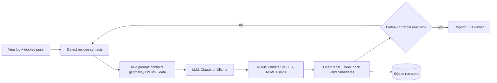

# AI-Guided Docking Pipeline

A generalised, AI-guided structure-based drug design pipeline. Works with any protein
target, any PDB structure, and any binding site (not limited to MRP1). It parses AutoDock
Vina logs, retrieves live ChEMBL reference data, auto-detects residue contacts, builds a
target-specific system prompt, calls Claude (or a local Ollama model) for scaffold
modification suggestions, validates returned SMILES with RDKit, and can auto-dock
candidates across multiple autonomous optimisation cycles.

Two entry points:
- `docking_pipeline.py`: command-line pipeline
- `docking_app_v2.py`: Streamlit web interface (autonomous iterative loop, in-browser
  3D pose viewer via 3Dmol.js, plateau-detection auto-stop)

<!-- TODO: add a screenshot of the app here (docs/screenshot.png) -->

## Quick start

### With Docker

```bash
docker build -t docking-app .
export ANTHROPIC_API_KEY="your-key-here"       # never commit this
docker run -p 8501:8501 -e ANTHROPIC_API_KEY -v "$(pwd)/data:/app/data" docking-app
# open http://localhost:8501
```

The image includes AutoDock Vina and OpenBabel. `./data` keeps your run history and saved poses.

### Without Docker

```bash
pip install -r requirements.txt
```

Install [AutoDock Vina](http://vina.scripps.edu/) and [OpenBabel](https://openbabel.org/)
locally (on Ubuntu: `sudo apt install openbabel autodock-vina`), and have a receptor PDBQT file
for your target.

```bash
export ANTHROPIC_API_KEY="your-key-here"       # required, never commit this
export VINA_PATH="/path/to/vina"               # optional override
export OBABEL_PATH="/path/to/obabel"           # optional override
streamlit run docking_app_v2.py
```

Upload a receptor PDBQT, enter target and grid details (pre-filled with MRP1/5UJA defaults),
optionally upload a Vina log and docked ligand PDBQT, and run one or more autonomous
optimisation cycles interactively, with 3D pose visualisation and per-cycle downloads.
Requires `docking_pipeline.py` in the same folder.

## Command-line usage

```bash
python docking_pipeline.py \
    --log compound_vina.log \
    --smiles "CCO..." \
    --receptor path/to/receptor.pdbqt \
    --center_x 45.0 --center_y 32.0 --center_z 18.0 \
    --size_x 25.0 --size_y 25.0 --size_z 25.0 \
    --target "EGFR kinase" \
    --pdb_id 1IEP \
    --cavity "ATP binding pocket, hinge region" \
    --key_residues "Thr790,Met793,Lys745,Glu762" \
    --chembl_id CHEMBL203 \
    --mode affinity \
    --chembl \
    --n 3 \
    --autodock \
    --yes
```

Output: `<name>_report.txt` with AI suggestions, RDKit validation, and docking results.

## How a cycle works



## Run history and reproducibility

Every web-app run is saved to `data/runs.db` (SQLite) with:

- the target, grid, Vina settings, LLM backend and model, and a SHA-256 of the receptor file,
- Python and package versions, the Vina version, and the git commit,
- start time, end time, and status (`completed`, `failed` or `cancelled`),
- one row per compound for every cycle: SMILES, Vina score (kcal/mol, more negative is better),
  and the saved pose in `data/poses/<run_id>/`.

```python
from provenance import RunStore
store = RunStore("data/runs.db")
run_id = store.list_runs()[0]["run_id"]
print(store.get_run(run_id)["params"])
print(store.best_results(run_id, n=5))
```

**What the "Fix random seed" option does:** it passes `--seed 42` to Vina, so Vina's search is
repeatable for a given prepared ligand file. The 3D structure of each ligand is generated from its
SMILES by OpenBabel, which is not seeded, so scores for the same SMILES can still differ slightly
between runs. See `NEXT_STEPS.md`.

## Tests

```bash
pip install -r requirements-dev.txt
pytest
```

CI runs the suite on every push (`.github/workflows/ci.yml`). Tests cover log and PDBQT parsing,
contact detection, SMILES validation, ADMET thresholds, prompt building, iteration-mode logic,
ChEMBL and LLM calls (with fakes, so no key or network is needed), Vina command construction, the
auto-grid helper, the run store, and real Vina/OpenBabel docking when those tools are installed.
Three tests are marked `xfail` on purpose: they document known issues listed in `NEXT_STEPS.md`.

## Notes

- Receptor/ligand structure files (`*.pdb`, `*.pdbqt`) and generated reports are excluded
  from version control by default (see `.gitignore`).
- Docking scores are computational estimates, not measured binding affinities.
- Built as part of a BSc final year project on computational MRP1 (ABCC1) inhibitor
  discovery at Imperial College London, generalised to support arbitrary targets.

<!-- TODO: choose a licence (MIT is common for portfolio projects) and add a LICENSE file -->
